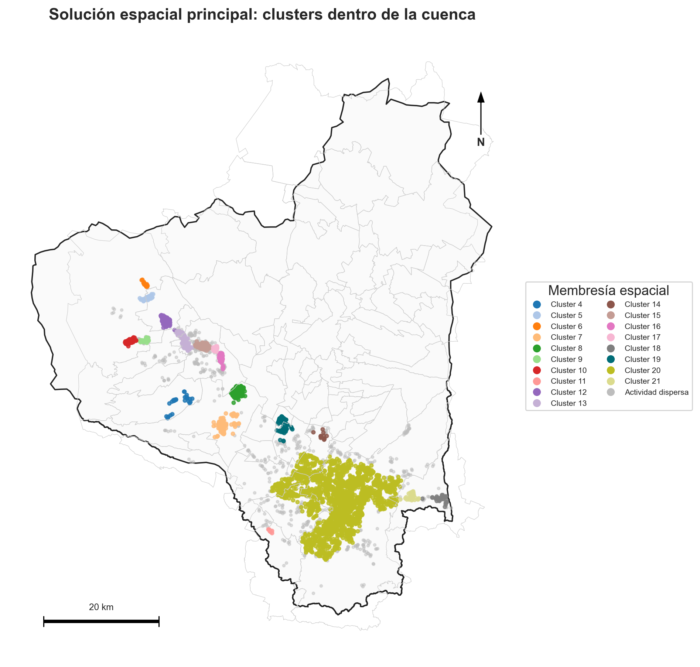
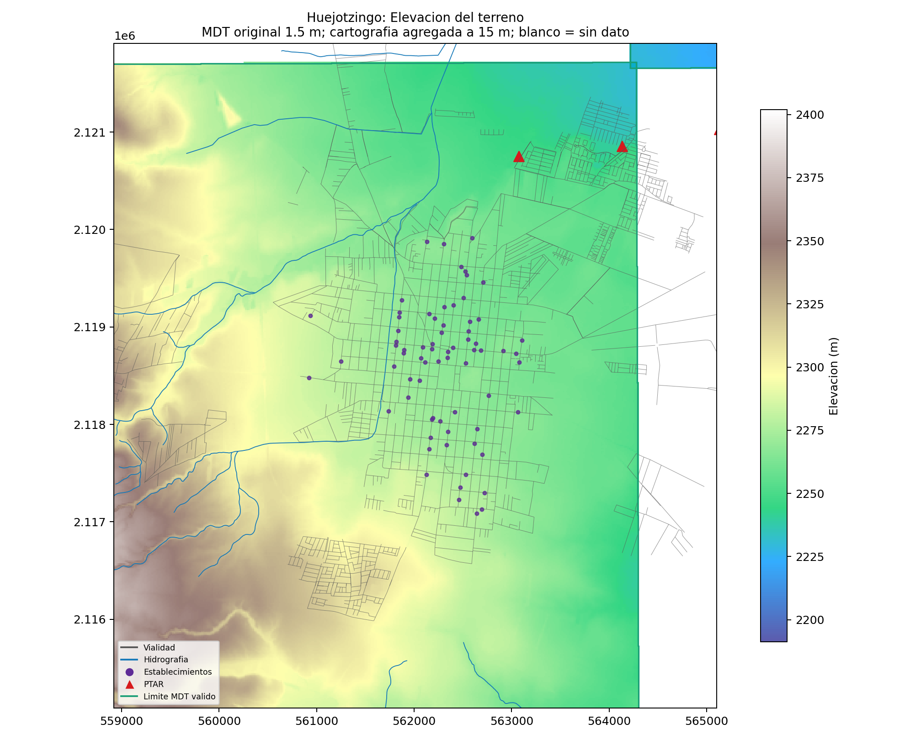

# Actividad textil y saneamiento en la cuenca del Alto Atoyac

**Análisis territorial reproducible para identificar concentraciones de establecimientos y explorar su relación con la infraestructura de tratamiento.**

Autora: **Nuria Arroyo Bustamante** · Universidad de las Américas Puebla.  
Estado documentado: **23 de octubre de 2026**.

## Empieza aquí

- **Para conocer y compartir el trabajo:** [entrega de lectura](entrega/LEEME.md), con reportes, mapas, datos seleccionados y explorador interactivo.
- **Para entender el avance:** [estado actual y límites](docs/ESTADO_ACTUAL.md).
- **Para revisar o reproducir:** [guía técnica](docs/REPRODUCIR.md), [fuentes](docs/FUENTES.md) y [mapa del repositorio](docs/MAPA_REPOSITORIO.md).

## Qué se ha construido

| Etapa | Resultado | Estado |
|---|---|---|
| 1. Universo económico | Filtros SCIAN/texto, contraste con evidencia MH y cinco modalidades regionales. | Base documentada. |
| 2. Concentraciones | 4,365 establecimientos de detección; 4,010 dentro de cuenca; comparación de 57 escenarios. | Cierre analítico validado. |
| 3. Infraestructura y territorio | PTAR, descargas, hidrografía, vialidades, terreno y exploración local de caminos. | En desarrollo; revisión vigente `12_vialidades_amplias`. |
| 4. Propuesta de colectores | Red común, caudales, capacidad receptora, cotas y costos. | Pendiente; aún no es diseño hidráulico. |

La parte 2 seleccionó HDBSCAN y detectó 22 clusters en el universo con borde; 18 intersectan la cuenca. La parte 3 trabaja ahora con **Santa Ana Xalmimilulco y la localidad de Huejotzingo**: 408 establecimientos, de los que 65 tienen prioridad alta/media.

## Hallazgos locales actuales

- **Huejotzingo:** 102 caminos individuales desde 34 prioritarios hacia tres PTAR candidatas. Cabecera Municipal y Paseo de los Sauces tienen cobertura de terreno completa en las trazas; Real Segovia, parcial.
- **Santa Ana:** 31 prioritarios sin ruta continua a esas tres plantas en los archivos viales disponibles. Se exploran 62 recorridos internos hacia dos extremos de calle para inspección.
- Los caminos se calculan con **Dijkstra por longitud vial**. La pendiente se evalúa después. Cada camino une un establecimiento con un destino; aún no se optimiza una red conjunta que reúna todos los aportantes.

**Interpretación:** concentración no demuestra contaminación; proximidad no demuestra conexión sanitaria; registro de PTAR no acredita operación ni capacidad libre. Los resultados orientan investigación y prefactibilidad.

## Vista del trabajo

| Concentraciones regionales | Integración local de terreno y establecimientos |
|---|---|
|  |  |

## Organización

```text
entrega/          Reportes, mapas y datos seleccionados para compartir
atoyac/          Proyecto analítico vigente: scripts, datos, documentos y resultados
docs/            Guías de lectura, reproducción, fuentes y organización
herramientas/    Verificación y preparación de la entrega
version_01/      Antecedente local y auditorías; se conserva para trazabilidad
mantenimiento/  Registro de limpieza y organización
```

La selección de productos vigentes está en [proyecto.json](proyecto.json). Las revisiones históricas conservan sus rutas porque los scripts y manifiestos las utilizan.

## Revisión rápida

```powershell
python -m pip install -r requirements.txt
python herramientas/verificar_repo.py
python herramientas/preparar_entrega.py
```

La entrega puede leerse sin instalar Python. Reconstruir los análisis requiere los insumos geográficos descritos en la [guía de reproducción](docs/REPRODUCIR.md). Los archivos nuevos en `data/raw` y `data/processed` son locales; su inventario se conserva en [el manifiesto de datos](atoyac/data/MANIFIESTO_FUENTES.csv).
